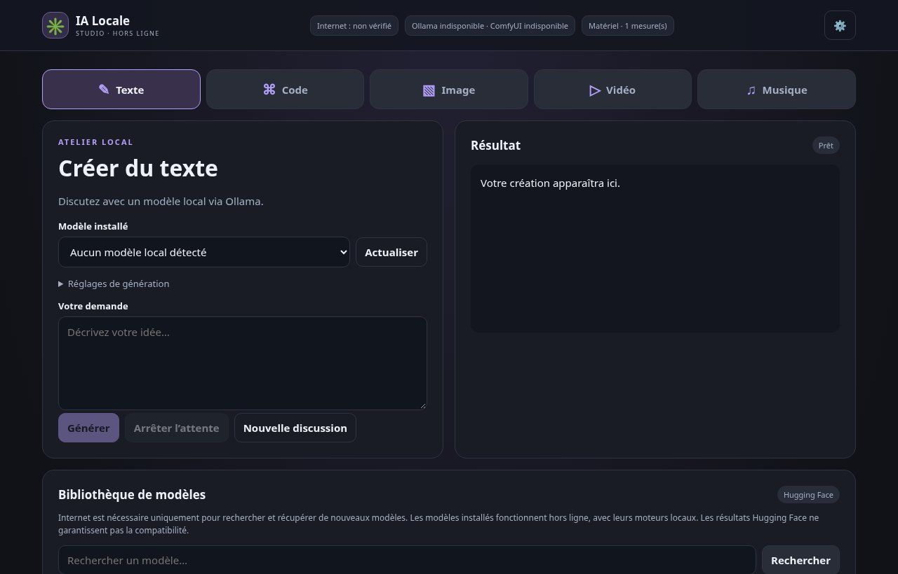
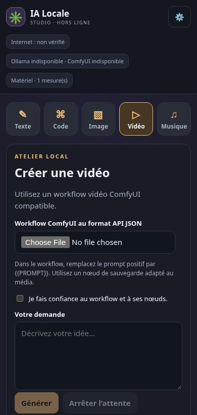

# IA Locale Studio

**Cinq ateliers de création IA dans une interface française, avec des modèles qui tournent sur ton appareil.**

[**Toutes les versions publiées →**](https://github.com/anderson76389/IA-Locale-Studio/releases)

| Plateforme | Téléchargement direct de la préversion `08a3ea46099f` | Démarrage |
| --- | --- | --- |
| **Windows x64** | [**Télécharger le .exe**](https://github.com/anderson76389/IA-Locale-Studio/releases/download/preview-08a3ea46099f/IA-Locale-Studio.exe) | Place le fichier dans un dossier dédié et lance-le. |
| **Linux x64** | [**Télécharger le binaire Linux**](https://github.com/anderson76389/IA-Locale-Studio/releases/download/preview-08a3ea46099f/IA-Locale-Studio-Linux) | Exécute `chmod +x IA-Locale-Studio-Linux`, puis `./IA-Locale-Studio-Linux`. |
| **Android 8+** | [**Télécharger l’APK**](https://github.com/anderson76389/IA-Locale-Studio/releases/download/preview-08a3ea46099f/IA-Locale-Studio.apk) | Installe l’APK ARM64/x86-64 et importe un modèle GGUF. |

## L’interface

**Windows et Linux** ouvrent l’interface sur [localhost:1420](http://localhost:1420/). **Texte** et **Code** utilisent Ollama. **Image**, **Vidéo** et **Musique** utilisent ComfyUI avec un modèle et un workflow compatibles. Installe les moteurs et les modèles localement pour générer hors ligne. [Guide PC et compilation](desktop/README.md)

**Android** embarque un moteur CPU pour **Texte** et **Code**. Les trois ateliers médias restent à intégrer sur Android. La signature de test peut empêcher une mise à jour par-dessus un APK précédent. [Guide Android et compilation](android/README.md)

Les versions publiées sont des préversions. Les essais avec génération réelle sur GPU et sur téléphone restent à effectuer. [Contrôles GitHub Actions](https://github.com/anderson76389/IA-Locale-Studio/actions) · [Empreintes SHA-256](https://github.com/anderson76389/IA-Locale-Studio/releases/download/preview-08a3ea46099f/SHA256SUMS.txt)
